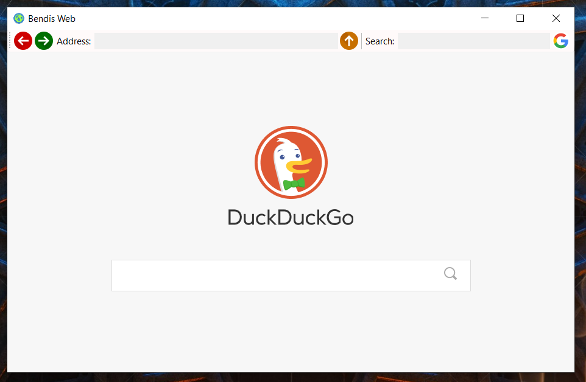

# BendisWeb — Desktop Browser Prototype

A small C# Windows Forms project using the built-in WebBrowser control. It provides address navigation, back and forward buttons, and Google search.

## Build and run

1. Clone or download this repository.
2. Open `BendisWeb/BendisWeb.sln` in Visual Studio with the **.NET desktop development** workload and the **.NET Framework 4.7.2 targeting pack**.
3. Build the solution and run it with **F5**.

## Usage

Enter a URL in the address field and use the navigation button to open it. Use the back and forward controls to move between visited pages, or enter a query in the search field.

## Screenshot

## Project scope

This is a learning project built around the legacy Windows Forms WebBrowser control. Modern websites may not render correctly in its browser engine.
